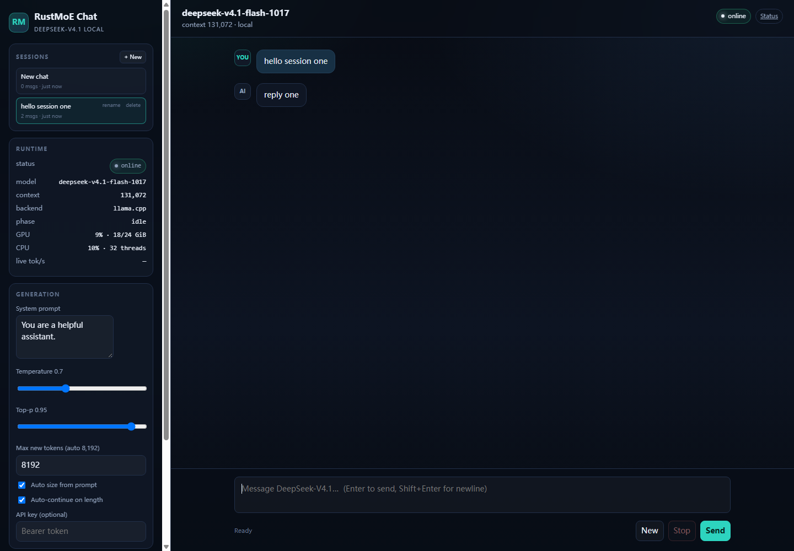
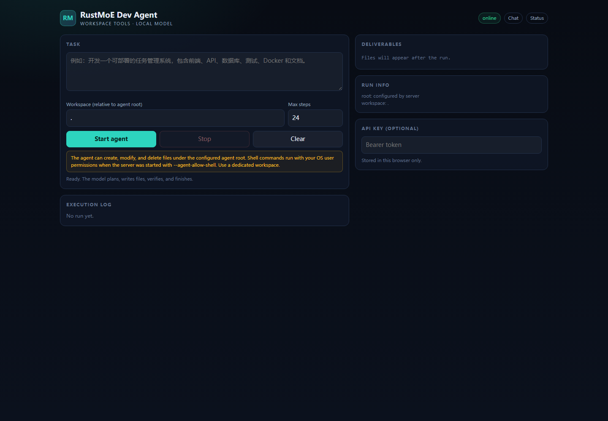
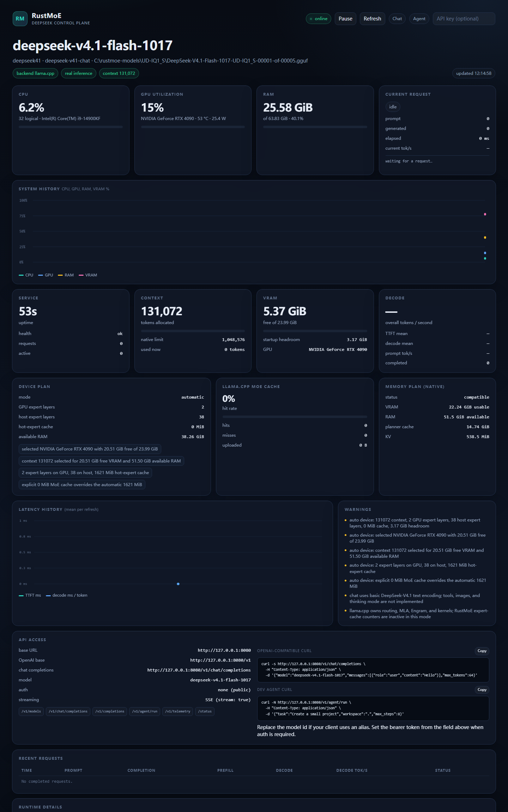

# RustMoE

RustMoE is a Rust control plane for running very large GGUF MoE models on
workstation-class hardware. It treats weight placement across VRAM, host RAM,
and NVMe as a first-class runtime concern instead of assuming the model fits in
VRAM.

This repository now executes real DeepSeek-V4.1-Flash-1017 tokens through a
reference llama.cpp backend, while RustMoE owns the GGUF inspection, memory
planning, CLI, HTTP/SSE API, tokenizer boundary, metrics, and lifecycle. A
deterministic simulation backend remains for tests and for running without
CUDA or model weights.

The validated low-memory path is:

- NVIDIA RTX 3060 12 GB VRAM
- 68 GB host RAM (the design minimum is 32 GB; the process commit peak was
  about 11.8 GB, and weights are mmap-streamed)
- 233 GB UD-IQ1_S model on NVMe (the design minimum is 500 GB free)
- all routed experts on the host with a 1 GiB GPU MoE cache, dense tensors on
  the GPU, lazy/mmap loading
- real completion: prompt "The capital of France is" -> " Paris. The capital"
- second validated class: RTX 4090 24 GB, automatic plan with 3 GPU expert
  layers; context 8192 in the first test and 64K/128K later validated

This is genuine model execution, not simulation. It is low-speed compatibility:
observed throughput was roughly 0.07-0.72 tokens/s on the 12 GB device. The same
planner scales from 16 to 32 GB VRAM and 32 to 256 GB RAM without fixed constants.

## What this version actually does

- Parses GGUF v2/v3 headers without touching tensor payloads.
- Discovers and validates split shards, tensor offsets, alignment, shapes, and
  quantization layouts.
- Knows the real DeepSeek-V4.1 metadata keys and tensor catalog:
  deepseek41, 40 layers, 5120 hidden, MLA, 384 routed experts with top-6 plus a
  shared expert, DSpark metadata, and the Engram/PLE table.
- Builds a VRAM/RAM/disk budget and computes expert cache capacity before load.
- Implements cost-aware two-tier expert cache bookkeeping and a top-K preserving
  scheduler with read coalescing and prefetch accounting.
- Implements a GPT-2 byte-level BPE tokenizer from GGUF metadata. The real
  DeepSeek vocabulary works, including the 129,280-token tokenizer.
- Exposes a CLI and an OpenAI-compatible HTTP API with SSE streaming,
  Prometheus metrics, request cancellation, and runtime diagnostics.
- Serves a deterministic simulation backend for end-to-end runtime tests.
- Executes real tokens through llama.cpp reference kernels using a narrow C ABI;
  the DeepSeek-V4.1 branch owns MLA, Engram, routing, and MoE dispatch.
- Exposes llama.cpp MoE cache telemetry (hits, misses, uploaded bytes) in the
  generation result and /v1/runtime.
- Chooses context and GPU/host expert placement from free VRAM and RAM by
  default; CUDA_VISIBLE_DEVICES is respected. Manual flags remain available.
- Includes a standalone MXFP4 GEMV CUDA kernel source. It is not linked yet.

## What this version does not do

- It is not a native Rust/CUDA DeepSeek implementation. Real execution is the
  llama.cpp reference backend behind a C ABI.
- It does not load the full model into RAM. mmap/lazy loading and CPU expert
  overrides keep the resident set bounded.
- It does not implement the full official Jinja chat template. It has a basic
  DeepSeek-V4.1 chat encoder for text, without tools, images, or thinking mode.
- It does not support images, DSpark speculative decoding, multi-GPU
  execution, or concurrent sessions. The engine is serialized by a mutex.
- It does not yet expose per-layer llama.cpp router selections. The cumulative
  llama.cpp MoE cache stats (hits, misses, uploaded bytes) are exposed through
  backend_cache, but RustMoE scheduler counters remain inactive in real mode.

Simulation output is labelled as simulation. Real output is labelled with
backend=llama.cpp and simulation=false.

## Verified model facts

The design brief asked for six facts to be checked before coding. The public
snapshot was inspected directly. Details and checksums are in
docs/model-snapshot.md.

| Fact | Observed |
|---|---|
| Architecture key | deepseek41, not deepseek_v41 |
| Layers | 40 |
| Hidden size | 5120 |
| Attention | MLA, q_lora 1280, latent/key 512, rope 64, 64 heads, 8 output groups |
| Routed experts | 384 per layer, top-6, one shared expert, sqrtsoftplus |
| Context | 1,048,576 tokens, sliding window 128 |
| Engram/PLE | layers 1 and 14, 768,022,850 rows, head dim 256 |
| DSpark | separate optional drafter, block 5, target layers 37..39 |
| Quant directory | UD-Q4_K_XL, 9 shards, 500.7 GB |

The name Q4_K_XL does not mean every tensor is Q4_K. In this directory:

| Role | GGML type | Bytes |
|---|---|---|
| Routed experts | MXFP4 | 288.78 GB |
| Engram/PLE table | MXFP8 extension type 43 | 202.76 GB |
| Dense Q8 tensors | Q8_0 | 8.69 GB |
| Norms, routers, small tensors | F32 | 0.47 GB |
| Total tensor bytes | mixed | 500.70 GB |

There are 1043 tensors. The three expert tensors occupy 18,800,640 bytes per
expert. A cold top-6 selection across all 40 layers moves about 4.51 GB per
token. That number, not the GPU FLOP count, is the central systems problem.

## Real DeepSeek execution on 12-24 GB

The reference branch is Unsloth llama.cpp PR 298, branch dsv41-all, commit
d1781c3. It contains the DeepSeek-V4.1 model, MXFP8 Engram table, sparse
attention, quantized K cache, and Engram host placement.

Build it once on Windows with CUDA:

    git clone --depth 1 --branch dsv41-all https://github.com/unslothai/llama.cpp.git .models/llama.cpp
    cmake -S .models/llama.cpp -B .models/llama-build -G "Visual Studio 18 2026" -A x64 ^
      -DGGML_CUDA=ON -DCMAKE_CUDA_ARCHITECTURES="86;89" -DLLAMA_CURL=OFF -DLLAMA_BUILD_TESTS=OFF
    cmake --build .models/llama-build --config Release --target llama llama-cli llama-server -- /m:16

Then build RustMoE with the reference feature:

    cargo build --release -p rustmoe-server --features llama

The helper scripts scripts/build-reference.ps1 and scripts/download-iq1-s.ps1
perform the same setup on Windows. The build script applies
patches/llama-moe-cache-stats.patch, which adds the MoE cache telemetry API.
Apply the same patch if you build llama.cpp manually.

Download the 5 IQ1_S shards (about 233 GB, fits a 500 GB disk) from:

    https://huggingface.co/unsloth/DeepSeek-V4.1-Flash-1017-GGUF/tree/main/UD-IQ1_S

Run a real completion. Automatic placement is the default:

    set CUDA_VISIBLE_DEVICES=1
    target\release\rustmoe.exe simulate ^
      .models\UD-IQ1_S\DeepSeek-V4.1-Flash-1017-UD-IQ1_S-00001-of-00005.gguf ^
      --backend llama --prompt "The capital of France is" --max-tokens 4

Automatic placement is the default. It reads free VRAM and available RAM,
honors CUDA_VISIBLE_DEVICES, and chooses context, GPU/host expert layers, and
MoE cache size. Use --no-auto-device for the manual override shown below.

Measured automatic plans: RTX 3060 12 GB selected 0 GPU expert layers and a
1143 MiB cache; RTX 4090 24 GB selected 3 GPU expert layers. With 64K context
it used 0 MiB MoE cache and about 18.1 GB VRAM; with 128K context it used 0 MiB
cache and about 20.9 GB VRAM. Both 64K and 128K completed real requests.

The manual 12 GB command used for the first measurements was:

    target\release\rustmoe.exe simulate ^
      .models\UD-IQ1_S\DeepSeek-V4.1-Flash-1017-UD-IQ1_S-00001-of-00005.gguf ^
      --backend llama --context 2048 --prompt "The capital of France is" ^
      --max-tokens 4 --gpu-layers 999 --cpu-moe-layers=-1 ^
      --moe-cache-mib 1024 --llama-batch 512 --threads 16 ^
      --load-mode 1 --lazy-mode on

Observed output on RTX 3060 12 GB:

    Paris. The capital

An eight-token continuation of "The quick brown fox" produced
". Jumps. Over the lazy dog" with 53.2 s prefill and 76.2 s decode. A
256-token length/stability run completed with 355 s decode and a 19.3 GB working
set; its greedy sample was newline-only, so it is not a quality example. Observed
timing for the France run was prompt 5 tokens, prefill 60.2 s, 4 decode tokens in
24.4 s. A chat request produced "Paris." with a 159 s prompt evaluation and
28.6 s decode. A four-token run decoded in 12.35 s (0.32 tokens/s) after a
32.4 s prefill. Throughput is 0.07-0.72 tokens/s. This is real inference and
low-speed compatibility, not interactive chat.

For the HTTP API:

    target\release\rustmoe.exe serve ^
      .models\UD-IQ1_S\DeepSeek-V4.1-Flash-1017-UD-IQ1_S-00001-of-00005.gguf ^
      --backend llama --addr 127.0.0.1:8080

The server resolves the device plan at startup and exposes it in /v1/runtime.
Open `http://127.0.0.1:8080/status` for the live dashboard (CPU/GPU/RAM/VRAM,
current request, system history, service, context, device plan, MoE cache,
latency history, recent requests, API access URLs/cURL, warnings, raw JSON). It
refreshes every second through /v1/telemetry.

Open `http://127.0.0.1:8080/chat` for a llama.cpp-style local chat page. It
streams `/v1/chat/completions`, keeps conversation history in the browser, and
shows live phase, GPU, CPU, and tok/s in the sidebar. Max new tokens is sized
from the prompt between 8192 and 262144 (capped by the active context), and
auto-continue keeps extending the same answer while finish_reason=length. A
Continue button remains for manual/disabled auto-continue. Sessions are stored in
browser localStorage: create, rename, switch, and delete separate conversations
from the sidebar.

## Local development agent

The server also exposes a guarded Dev Agent at `http://127.0.0.1:8080/agent`.
It can list/read/write files, create directories, glob, grep, and (with explicit
opt-in) run shell commands inside a configured workspace. The model follows
plan -> architecture -> code -> UI -> docs -> deploy -> verify and writes the
complete project into that workspace. Use a dedicated directory and review all
generated code before production; see [docs/agent.md](docs/agent.md) for the
security model, limits, and API.

    set RUSTMOE_AGENT_ROOT=F:\projects
    set RUSTMOE_AGENT_ALLOW_SHELL=1
    startdeepseek.bat

For a manual placement, add --no-auto-device and the explicit flags.

### Windows RTX 4090 24 GB + 64 GB launcher

A ready-to-run launcher is included for the 24 GB / 64 GB class:

    startdeepseek.bat --check
    startdeepseek.bat
    startdeepseek.bat 65536
    testdeepseek.bat
    restartdeepseek.bat
    move-model-to-ssd.bat
    disks.bat

The launcher prints the model drive type and a cold-load estimate. On the
current F: HDD the 217 GiB model needs roughly 12-19 minutes to load; on the C:
NVMe it needs roughly 1-3 minutes. On this host C: is the only NVMe volume;
G:/H: are Samsung 870 EVO SATA SSDs, not NVMe. move-model-to-ssd.bat copies the model to
C:\rustmoe-models (one time, about 20 minutes) and writes a pointer that the
launcher picks up automatically.

During the long load, a terminal spinner shows elapsed time. The ready banner is
printed only after the HTTP listener has bound, with URL, model, backend,
context, GPU placement, cache, and the chat endpoint.

--check validates the executable, model shard, DLLs, and 4090 detection without
loading weights. The normal launch finds the physical 4090 index, sets
CUDA_VISIBLE_DEVICES, and lets automatic placement choose context, GPU/host
expert layers, and MoE cache. The default is 131072 (128K). startdeepseek.bat 65536 requests 64K; both were
executed on the RTX 4090. /v1/models exposes context_length, context_window,
and max_model_len as 131072, with max_context_length 1048576. A 700-word prompt
was also tested; prefill batches are split to the backend n_batch so long code
agent prompts no longer hit the llama.cpp batch assertion.

At 128K, 24 CPU expert threads measured 4.03 decode tokens/s vs 3.21 with 16
threads on the i9-14900KF (8-token test). A 279 MiB automatic MoE cache dropped
the same 24-thread run to 1.86 tok/s because it had no hits; with cache 0 it
measured 4.13 tok/s. The launcher defaults to 24 threads and cache 0. Set
RUSTMOE_MOE_CACHE to a larger value only after checking the hit rate. The status
page shows decode tok/s when available and falls back to overall tokens/s for
one-token replies.

restartdeepseek.bat stops only a rustmoe process listening on the configured
port, then starts the new binary. Use it after rebuilding so a stale server does
not keep serving old routes.

If a client reports 404, the API is usually healthy but configured with a wrong
base URL or model name. Two base URLs work: `http://127.0.0.1:8080/v1` for
OpenAI SDKs and `http://127.0.0.1:8080` for DeepSeek-style clients that append
`/chat/completions` themselves. Do not use the full endpoint as `base_url`, and
do not duplicate `/v1`. Run `testdeepseek.bat` to verify `/health`, `/v1/models`, and a
real `/v1/chat/completions` call. `/v1/responses` is not implemented. The
current build accepts deepseek-chat and related model aliases; restart an older
server to pick that up.

Use /v1/completions for raw prompts. /v1/chat/completions is OpenAI Chat
Completions compatible for text and streaming; an OpenAI SDK or a DeepSeek client
that uses the same shape can point at base_url http://127.0.0.1:8080/v1 with
api_key local and model deepseek-v4.1-flash-1017 (deepseek-chat is an alias).
Tool calls, reasoning_content/thinking, images, JSON mode, n>1, and
/v1/responses are not implemented. See docs/api.md for the exact compatibility
matrix, docs/real-backend.md for the backend, and docs/performance.md for the
thread/cache measurements and the Strata comparison.

The build script stages llama.dll, ggml DLLs, and CUDA 12 runtime DLLs beside
the Rust executable. If the reference directories move, set LLAMA_CPP_DIR and
LLAMA_BUILD_DIR.

## Quick start with the tiny fixture

The fixture is synthetic and small. It exercises parsing, validation, planning,
scheduler bookkeeping, tokenizer, CLI, HTTP, SSE, and metrics. It is not a
language model.

    cargo build --release
    cargo run -q -p rustmoe-server -- inspect fixtures/tiny-ds41/tiny-ds41-00001-of-00001.gguf
    cargo run -q -p rustmoe-server -- validate fixtures/tiny-ds41/tiny-ds41-00001-of-00001.gguf
    cargo run -q -p rustmoe-server -- plan fixtures/tiny-ds41/tiny-ds41-00001-of-00001.gguf --context 128 --vram 12GiB --ram 32GiB --gpu-cache 4GiB --host-cache 8GiB
    cargo run -q -p rustmoe-server -- simulate fixtures/tiny-ds41/tiny-ds41-00001-of-00001.gguf --context 64 --max-tokens 8

The released binary is target/release/rustmoe.exe on Windows and
target/release/rustmoe elsewhere.

## Inspecting a real model header

Shard 1 of the real Q4_K_XL directory is only 5.78 MB because it contains
metadata and the tokenizer. It can be inspected alone:

    rustmoe inspect /models/DeepSeek-V4.1-Flash-1017-UD-Q4_K_XL-00001-of-00009.gguf --single-file
    rustmoe tokenize /models/DeepSeek-V4.1-Flash-1017-UD-Q4_K_XL-00001-of-00009.gguf --single-file --text "Hello, world!"

The real tokenizer produced:

    ids:     [19923, 14, 2058, 3]
    tokens:  ["Hello", ",", "Ġworld", "!"]
    decoded: "Hello, world!"

The joyai-llm pre-tokenizer is not byte-for-byte verified, so the tokenizer
reports exact=false. The BPE merge loop and byte alphabet are exact.

## Validating a complete split

Pass shard 1. RustMoE discovers the other expected shards from the filename and
fails if one is missing:

    rustmoe validate /models/DeepSeek-V4.1-Flash-1017-UD-Q4_K_XL-00001-of-00009.gguf

Validation checks split continuity, header bounds, tensor alignment, tensor
shapes, expert layout consistency, quantization support, and tokenizer
metadata. Unknown quantization layouts are errors, not guesses.

## Planning memory

Planning requires the complete tensor catalog:

    rustmoe plan /models/DeepSeek-V4.1-Flash-1017-UD-Q4_K_XL-00001-of-00009.gguf \
      --context 8192 --vram 24GiB --ram 64GiB --cache-dtype f16 \
      --gpu-cache 10GiB --host-cache 40GiB

The plan prints:

- usable VRAM after display, runtime, safety, KV, and workspace reserves;
- whether the dense spine is resident in VRAM or offloaded to RAM;
- GPU and host expert cache capacity in experts and percent of all experts;
- KV bytes per component and per token;
- cold NVMe and PCIe I/O time per token, with an explicit warning that this is
  not a throughput prediction;
- an automatically reduced prefill chunk; input is never silently truncated.

12 GB VRAM with 32 GB RAM is a compatibility target, not an interactive target.
The planner is allowed to say INSUFFICIENT.

## Serving the simulation API

    rustmoe serve fixtures/tiny-ds41/tiny-ds41-00001-of-00001.gguf \
      --addr 127.0.0.1:8080 --context 64 --prefill-chunk 16 \
      --gpu-cache 128KiB --host-cache 256KiB

Endpoints:

| Method | Path | Purpose |
|---|---|---|
| GET | /health | liveness and simulation flag |
| GET | /v1/models | OpenAI model list |
| GET | /v1/runtime | model facts, plan, scheduler and cache state |
| GET | /metrics | Prometheus text |
| POST | /v1/tokenize | GGUF BPE tokenization |
| POST | /v1/cache/reset | reset cache and scheduler counters |
| POST | /v1/chat/completions | chat completion or SSE stream |
| POST | /v1/completions | text completion or SSE stream |

Chat request:

    {
      "model": "RustMoE Tiny DS41 Fixture",
      "messages": [{"role": "user", "content": "Hi"}],
      "max_tokens": 8,
      "temperature": 0.0,
      "seed": 7
    }

Every response includes rustmoe.simulation=true and the HTTP header
x-rustmoe-simulation: true. Streaming sends OpenAI-shaped chunks and ends with
data: [DONE]. Client disconnect cancels the blocking generation task.

Optional bearer auth: pass --api-key secret. Health, models, and metrics remain
public.

## Architecture

    CLI / OpenAI HTTP / SSE
              |
        Runtime assembly
              |
    +---------+----------+------------------+
    | GGUF parser        | Memory planner   |
    | splits, metadata   | VRAM/RAM/NVMe    |
    | tensor catalog     | KV and reserve   |
    +---------+----------+------------------+
              |
    +---------+----------+------------------+
    | Expert scheduler   | Tiered caches    |
    | top-K preserved    | GPU / host / SSD |
    | coalesce, prefetch | cost-aware LFU   |
    +---------+----------+------------------+
              |
       Inference backend boundary
              |
     Simulation now; CUDA/native later

The scheduler rejects a route with fewer than the configured top-K experts,
duplicate experts, a missing layer, or a missing shared expert. A small cache
causes eviction, not semantic reduction.

## Repository layout

    crates/gguf           streaming GGUF v2/v3 and split discovery
    crates/quant          tensor layouts and reference dequantizers
    crates/model          DeepSeek-V4.1 facts, catalog, validation
    crates/attention      MLA state geometry and KV budget
    crates/memory         VRAM/RAM/disk planner
    crates/io-engine      positioned reads and mmap expert store
    crates/expert-cache   cost-aware GPU/host cache bookkeeping
    crates/scheduler      top-K preserving expert scheduling
    crates/backend        backend trait and deterministic simulator
    crates/backend-llama  llama.cpp reference execution through a C shim
    crates/tokenizer      GGUF GPT-2 byte-level BPE
    crates/inference      prefill, decode, sampling, UTF-8 streaming
    crates/telemetry      counters, latency histograms, Prometheus
    crates/server         CLI and OpenAI-compatible HTTP
    kernels/cuda          standalone MXFP4 GEMV prototype
    patches/              local llama.cpp cache-telemetry patch
    scripts/              reference build, download, and run helpers
    fixtures/tiny-ds41    generated synthetic fixture
    docs/                 architecture, formats, planning, snapshot, API

## Correctness and safety rules

- Unsupported quantization layouts fail before load.
- Split files are discovered from shard 1 and all expected shards must exist.
- Tensor ranges must be aligned and inside their shard.
- Router top-K is a hard contract. Cache pressure never drops an expert.
- Prefill chunk size shrinks; prompt tokens do not.
- The memory planner reports failure instead of quietly overcommitting.
- The simulation flag is present in CLI output, API JSON, and response headers.
- The tokenizer reports whether its pre-tokenizer is verified.

## Tests

    cargo test --workspace
    cargo clippy --workspace --all-targets
    cargo fmt --check

The suite covers GGUF parsing and bounds, quantization block sizes and
dequantization, model facts, validation, memory budgets, cache policies,
scheduler invariants, tokenizer merges and streaming UTF-8, API shape, SSE
termination, auth, and metrics.

The CUDA prototype is compiled separately and has no numerical parity test yet.

## Status and roadmap

| Area | Status |
|---|---|
| GGUF v2/v3 and split validation | implemented |
| DeepSeek-V4.1 metadata and catalog | implemented |
| Memory planning | implemented |
| Top-K scheduler and caches | implemented as control plane |
| Tokenizer | usable, pre-tokenizer exactness reported |
| OpenAI API and SSE | implemented on simulation and llama.cpp backends |
| Real DeepSeek execution | implemented through llama.cpp reference backend |
| 12 GB VRAM real decode | validated on RTX 3060 12 GB, low-speed |
| 24 GB VRAM real decode | validated on RTX 4090 with auto placement |
| 16-32 GB VRAM planning | unit-tested auto planner; 24 GB executed |
| Native Rust/CUDA forward | not implemented |
| CUDA kernels | one prototype, not integrated |
| Real model benchmarks | measured for IQ1_S on 12 GB, see docs/benchmark.md |
| llama.cpp MoE cache telemetry | exposed as backend_cache |
| 256-token stability | completed; output quality not asserted |

The next step is to instrument llama.cpp's router and MoE cache decisions so
RustMoE's scheduler and metrics apply to real execution, then replace operator
families with native kernels behind a logits-parity gate.

Real-backend setup and flags are in docs/real-backend.md.

## License

MIT. See LICENSE.
created by clarkzhu 
github: https://github.com/clarkzhu2020
blog: https://clarkzhu.blog
